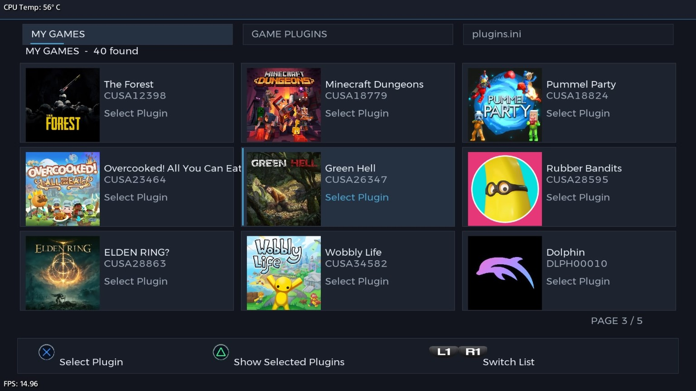
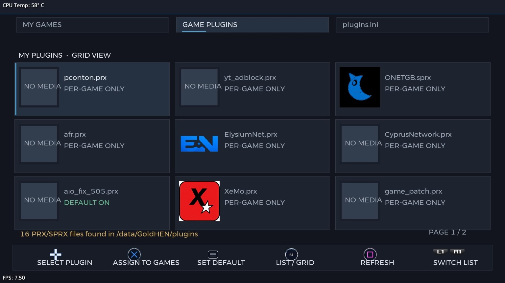
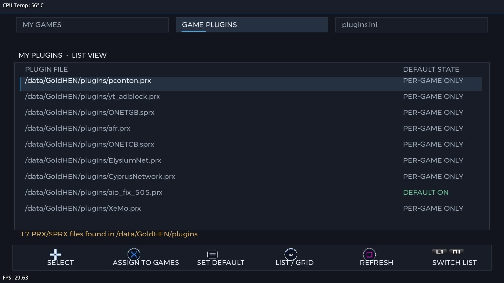
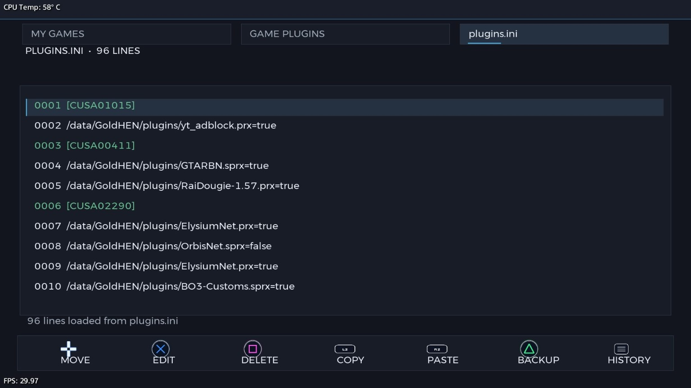
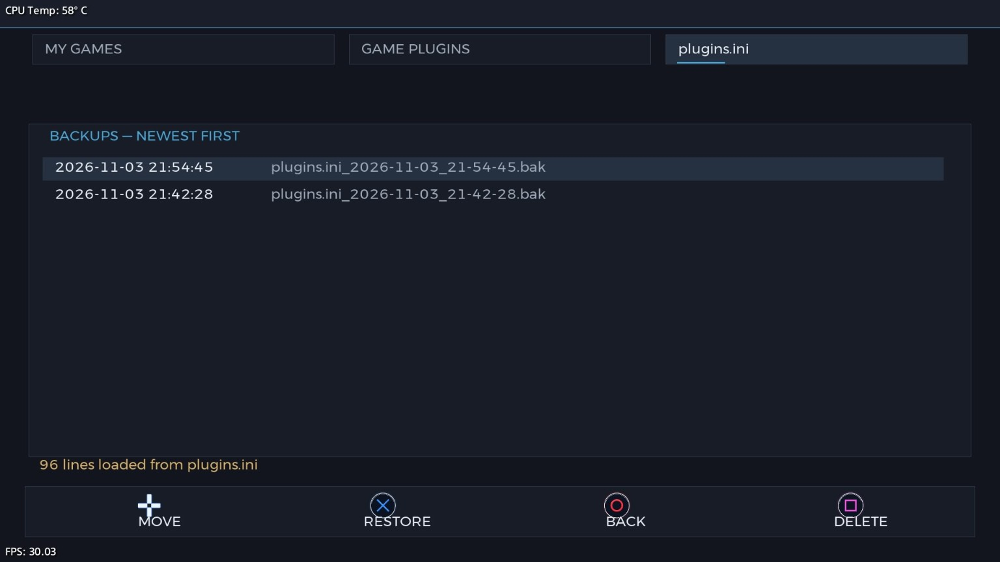

# PS4 Plugins Manager

A PlayStation 4 homebrew application for managing GoldHEN game plugins and the `plugins.ini` configuration directly from your console.

Browse installed games, assign plugins to one or multiple titles, manage your plugin collection, set default plugins, and edit or back up `plugins.ini` using the PS4 controller.

## Screenshots

The screenshots below show the current application interface.

### My Games

Browse the games and applications installed on the console.

### Game Plugins — Grid View

Browse plugin files using the artwork-based grid layout.

### Game Plugins — List View

Browse plugin filenames and check how each plugin is used in `plugins.ini`.

### GET — Internet

Browse the online plugin catalog and get plugins from the Internet.

### GET — USB

Browse plugin files available on a connected USB storage device.

### GET — File Browser

Browse files and folders on the console and choose plugin files.

### `plugins.ini` Editor

Review and edit the entries in `plugins.ini` directly on the console.

### Backup History

Browse manual backups created from the `plugins.ini` screen.

## Features

- Browse games and applications installed on the PS4.
- Manage plugin files from the Game Plugins screen.
- Assign a plugin to one or multiple games.
- Set a plugin as the default plugin for all applications.
- View plugin usage information based on its entries in `plugins.ini`.
- Switch between List View and Grid View.
- Get plugins from three sources:
  - **Internet** — browse the online plugin catalog.
  - **USB** — browse plugin files on connected USB storage.
  - **File Browser** — browse files and folders on the console.
- Edit `plugins.ini` directly from the console.
- Copy, paste, and delete configuration entries.
- Create and browse manual backups of `plugins.ini`.

## User Guide

### My Games

The My Games screen displays the games and applications installed on your console. Select a game to manage the plugins assigned to it, or view the plugins already enabled for that title.

### Game Plugins

Game Plugins displays the available plugin files. Use the screen controls to select plugins, assign them to games, set a default plugin, refresh the list, and switch between List View and Grid View.

In List View, the filename is displayed without the full `/data/GoldHEN/plugins/` directory prefix. The usage column indicates whether the plugin is configured as a default plugin or how many game entries use it in `plugins.ini`.

### GET

The GET menu provides three ways to find plugin files:

| Source | Description |
|:--|:--|
| **Internet** | Browse the online plugin catalog and get plugin files from the Internet. |
| **USB** | Browse plugin files stored on a connected USB device. |
| **File Browser** | Navigate the console's file system and choose plugin files from an available location. |

The Internet catalog is online content; its catalog artwork and plugin entries are retrieved from the online source rather than being bundled as local catalog images in the PKG.

### `plugins.ini` Editor

Use this screen to manage the entries in `plugins.ini` directly on your console.

| Control | Action |
|:--|:--|
| D-Pad / Analog Sticks | Navigate through the entries |
| **✕ Cross** | Edit the selected line using the on-screen keyboard |
| **□ Square** | Delete the selected line |
| **L2** | Copy the selected line |
| **R2** | Paste the copied line below the selected line |
| **△ Triangle** | Create a backup of `plugins.ini` |
| **OPTIONS** | Open the list of existing backups |

> [!IMPORTANT]
> Backups are **not created automatically**. Press **△ Triangle** to create a backup before editing `plugins.ini`.

## Notes

- Plugin configuration is managed through GoldHEN's `plugins.ini`.
- The Internet source requires an active network connection.
- USB browsing requires a connected and mounted USB storage device.
- Be careful when editing `plugins.ini`. Incorrect paths or entries may prevent plugins from loading as expected.
- Creating a backup before making configuration changes is strongly recommended.

## Building from Source

This repository contains the project source code. The OpenOrbis Toolchain is a separate dependency and is **not included** in this repository.

See **[OPENORBIS_SETUP.md](OPENORBIS_SETUP.md)** for the required toolchain files, host tools, and setup notes before building.

> Windows build support is provided in the build scripts but has not yet been verified in a tested Windows build environment.

## Project Structure

| Path | Description |
|:--|:--|
| `PS4PluginEditor/` | Main application source |
| `_common/` | Shared source and graphics files |
| `assets/` | Application assets |
| `sce_sys/` | Application system resources and metadata |
| `sce_module/` | Module-related project files |
| `libjbc/` | `libjbc` build script and integration files |
| `OPENORBIS_SETUP.md` | OpenOrbis Toolchain setup requirements |

## Contributing

Bug reports, suggestions, and improvements are welcome. Please include clear reproduction steps and relevant details when reporting an issue.

## Disclaimer

This project is provided as-is. Use it at your own risk. Always keep a backup of your plugin configuration before making changes.
