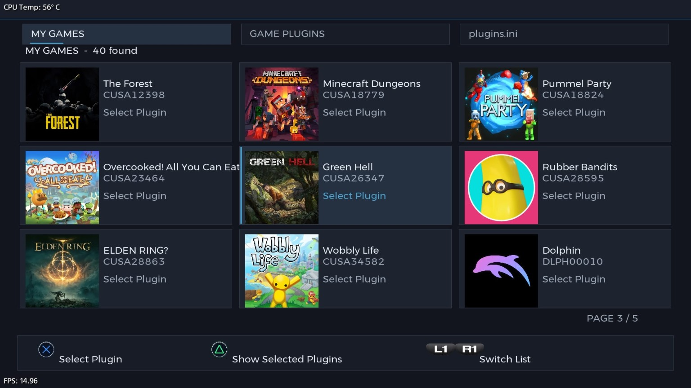
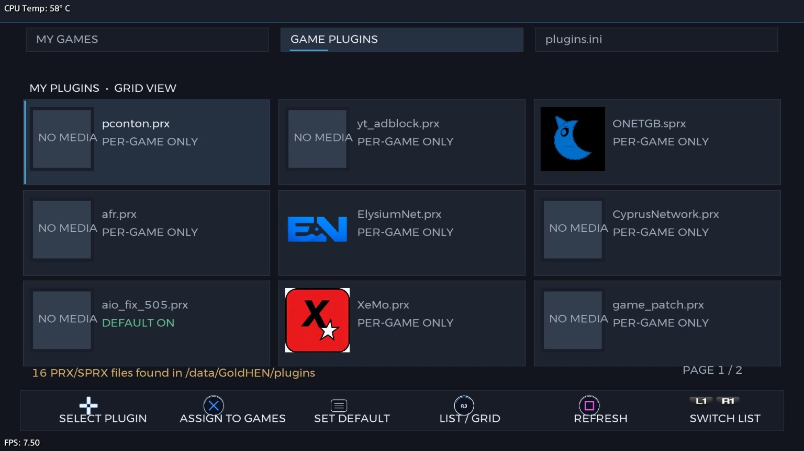
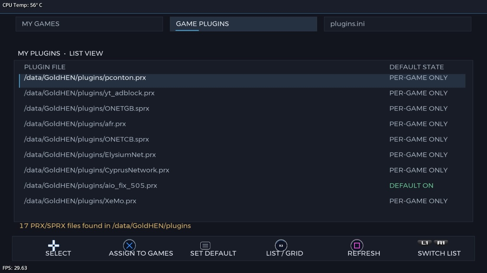
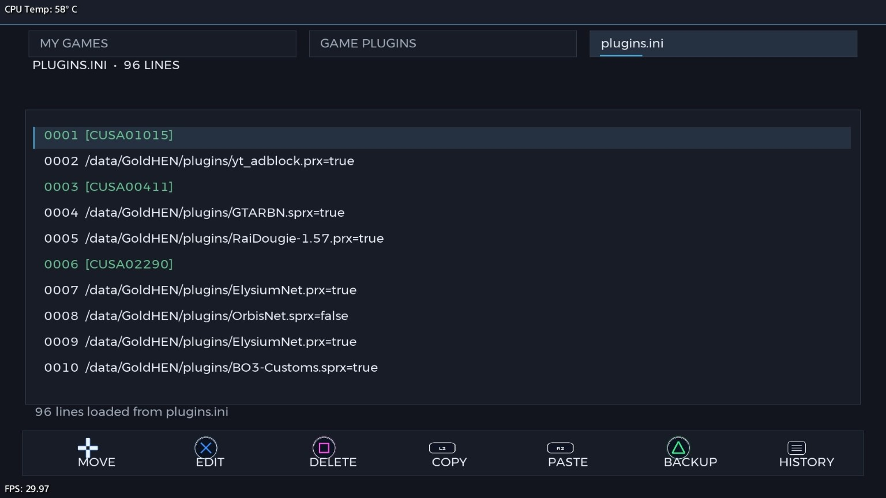
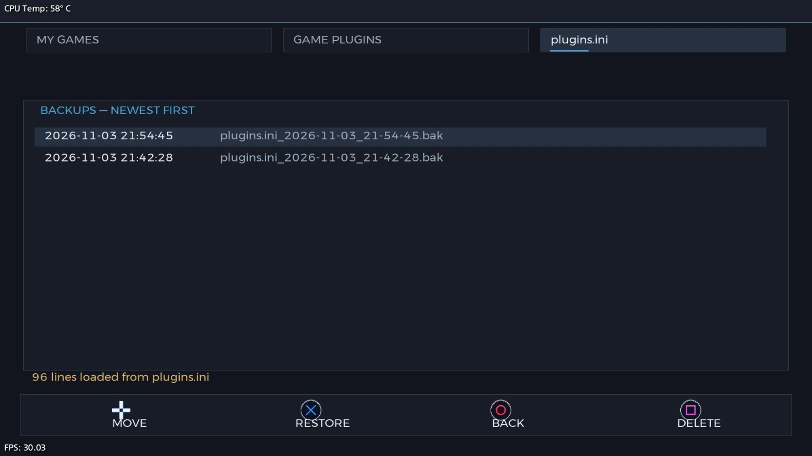

# PS4 Plugins Manager

A PlayStation 4 homebrew application for managing game plugins and their `plugins.ini` configuration directly from the console.

Browse installed games, assign plugins to one or multiple titles, configure a default plugin, and maintain `plugins.ini` using the PS4 controller.

## Screenshots

### Games List
Browse the games and applications installed on the console.



### My Plugins — Grid View
View plugins with their matching artwork. Artwork is loaded when a PNG with the same base filename as the plugin is available.



### My Plugins — List View
See plugin paths and whether each plugin is configured as a default plugin or for individual games.



### plugins.ini Editor
Review and edit the entries in `plugins.ini` directly on the console.



### Backup History
Browse the manual backups created from the `plugins.ini` screen.



## Features

- Browse games and applications installed on the PS4.
- Select plugin files from the console's `plugins` directory.
- View the plugins enabled for a selected game.
- Assign one plugin to multiple games.
- Set a plugin as the default for all applications.
- Switch between a compact list and an image-based plugin view.
- Edit `plugins.ini` from the console.
- Copy, paste, and delete configuration entries.
- Create and browse manual backups of `plugins.ini`.

## User Guide

### Games List

The Games List displays the applications installed on your console.

| Control | Action |
|:--|:--|
| D-Pad / Analog Sticks | Navigate through the games list |
| **✕ Cross** | Open the plugin list from the `plugins` folder. Multiple plugin files can be selected. |
| **△ Triangle** | View the plugins enabled for the selected game. |

### My Plugins

My Plugins displays the available plugin files. Use **L1 / R1** to switch between the available lists.

| Control | Action |
|:--|:--|
| D-Pad / Analog Sticks | Navigate through the plugin list |
| **✕ Cross** | Open the games list and assign the selected plugin to one or more games |
| **OPTIONS** | Set the selected plugin as the default plugin, loaded with all applications |
| **R3** | Switch between list view and image view |
| **□ Square** | Reload the plugin list |

#### Plugin artwork

In image view, the application looks for a `.png` image with the same base name as the plugin. Keep the image in the appropriate plugins directory.

For example:

```text
orbisnet.sprx
orbisnet.png
```

If no matching image is found, the application uses its default image.

### plugins.ini Editor

Use this screen to manage the entries in `plugins.ini` directly on your console.

| Control | Action |
|:--|:--|
| D-Pad / Analog Sticks | Navigate through the entries |
| **✕ Cross** | Open the on-screen keyboard to edit the selected line |
| **□ Square** | Delete the selected line |
| **L2** | Copy the selected line |
| **R2** | Paste the copied line below the selected line |
| **△ Triangle** | Create a backup of `plugins.ini` |
| **OPTIONS** | Open the list of existing backups |

> [!IMPORTANT]
> Backups are **not created automatically**. Press **△ Triangle** to create a backup before editing `plugins.ini`.

## Notes

- Plugin files must be placed in the console's `plugins` directory to appear in the plugin selection list.
- The image-view feature expects artwork to use the same base filename as its plugin (for example, `example.sprx` and `example.png`).
- Be careful when editing `plugins.ini`. Incorrect paths or entries may prevent plugins from loading as expected.
- Creating a backup before making configuration changes is strongly recommended.

## Building from Source

This repository contains the project source code. The OpenOrbis Toolchain is a separate dependency and is **not included** in this repository.

See **[OPENORBIS_SETUP.md](OPENORBIS_SETUP.md)** for the required toolchain files, host tools, and setup notes before building.

> Windows build support is provided in the build scripts but has not yet been verified in a tested Windows build environment.

## Project Structure

| Path | Description |
|:--|:--|
| `PS4PluginEditor/` | Main application source |
| `_common/` | Shared source and graphics files |
| `assets/` | Application assets |
| `sce_sys/` | Application system resources and metadata |
| `sce_module/` | Module-related project files |
| `libjbc/` | `libjbc` build script and integration files |
| `OPENORBIS_SETUP.md` | OpenOrbis Toolchain setup requirements |

## Contributing

Bug reports, suggestions, and improvements are welcome. Please include clear reproduction steps and relevant details when reporting an issue.

## Disclaimer

This project is provided as-is. Use it at your own risk. Always keep a backup of your plugin configuration before making changes.
