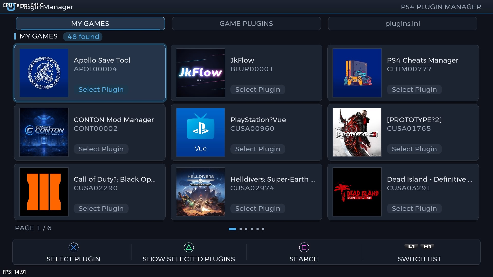
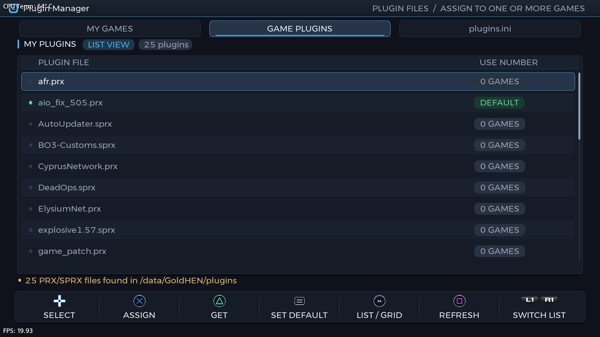
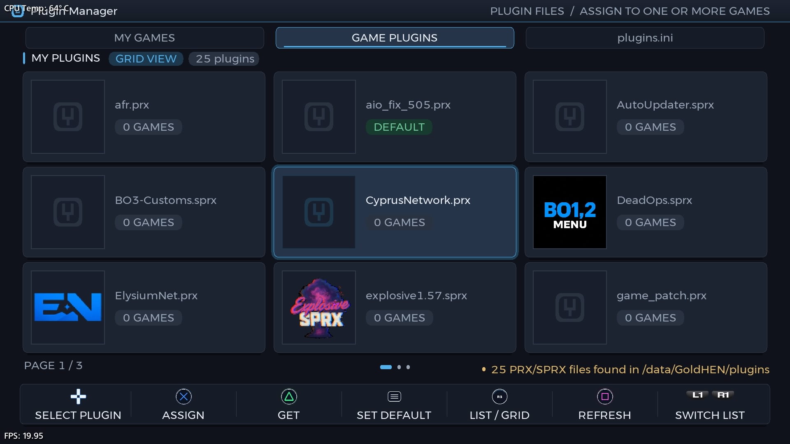
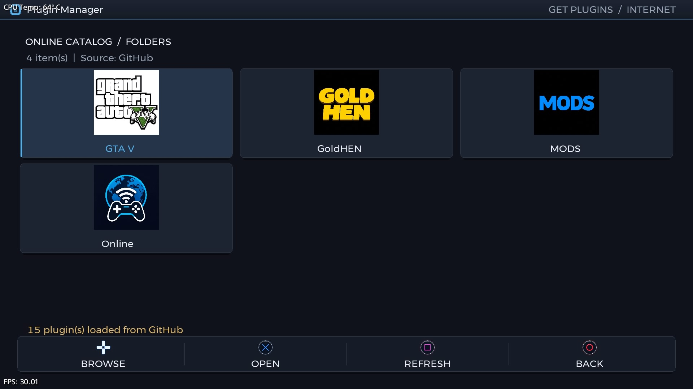
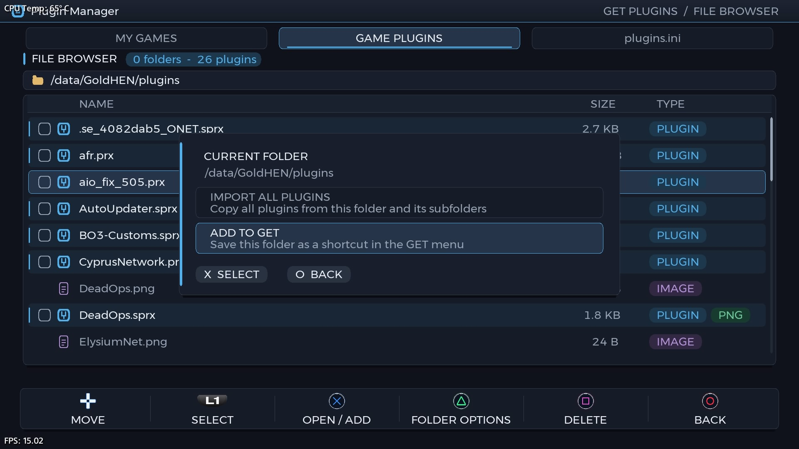
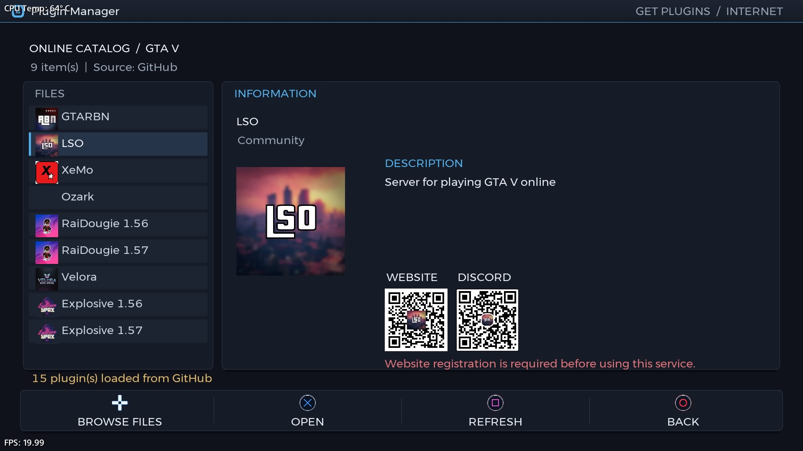
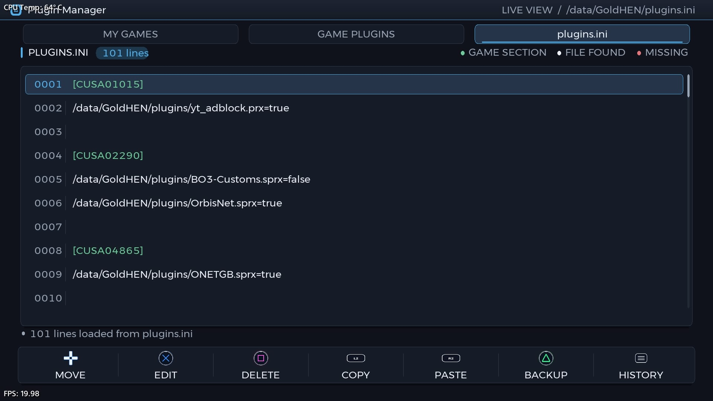

# PS4 Plugins Manager

A PlayStation 4 homebrew application for managing GoldHEN game plugins and the `plugins.ini` configuration directly from your console.

Browse installed games, manage plugin files, assign plugins to games, get plugins from different sources, and edit or back up `plugins.ini` using your PS4 controller.

## Screenshots

### My Games

Browse the games and applications installed on your PS4.

### Game Plugins — List View

View available plugin files and manage their assignments.

### Game Plugins — Grid View

Browse plugins in the artwork-based grid layout.

### GET — Internet

Browse and get plugins from the online catalog.

### Online Plugin Preview

Preview online plugin content.

### File Browser

Browse folders and select files from the console.

### Game Preview

Example of game artwork displayed by the application.

### `plugins.ini` Editor

Review and edit GoldHEN plugin configuration entries.

## Features

- Browse games and applications installed on the PS4.
- Manage plugin files from the Game Plugins screen.
- Assign plugins to games.
- Set a plugin as the default plugin for all applications.
- View plugin usage information based on its entries in `plugins.ini`.
- Switch between List View and Grid View.
- Get and browse plugins through the available GET sources:
  - **Internet** — browse the online plugin catalog.
  - **USB** — browse plugin files on connected USB storage.
  - **File Browser** — navigate the console's file system and select plugin files.
- Edit `plugins.ini` directly from the console.
- Copy, paste, and delete configuration entries.
- Create and browse manual backups of `plugins.ini`.

## User Guide

### My Games

The My Games screen displays games and applications installed on your console. Select a title to manage the plugins assigned to it.

### Game Plugins

The Game Plugins screen displays available plugin files. Use the available controls to select plugins, assign them to games, set a default plugin, refresh the list, and switch between List View and Grid View.

In List View, plugin usage information is based on the entries found in `plugins.ini`.

### GET

The GET menu provides different ways to find plugin files:

| Source | Description |
|:--|:--|
| **Internet** | Browse the online plugin catalog and get plugin files over the network. |
| **USB** | Browse plugin files stored on a connected USB device. |
| **File Browser** | Navigate the console's file system and choose plugin files from an available location. |

The Internet catalog is online content. Its entries and preview artwork are retrieved from the online source rather than being bundled as a local catalog in the PKG.

### `plugins.ini` Editor

Use this screen to manage the entries in `plugins.ini` directly on your console.

| Control | Action |
|:--|:--|
| D-Pad / Analog Sticks | Navigate through the entries |
| **✕ Cross** | Edit the selected line using the on-screen keyboard |
| **□ Square** | Delete the selected line |
| **L2** | Copy the selected line |
| **R2** | Paste the copied line below the selected line |
| **△ Triangle** | Create a backup of `plugins.ini` |
| **OPTIONS** | Open the list of existing backups |

> [!IMPORTANT]
> Backups are not created automatically. Press **△ Triangle** to create a backup before editing `plugins.ini`.

## Notes

- Plugin configuration is managed through GoldHEN's `plugins.ini`.
- The Internet source requires an active network connection.
- USB browsing requires a connected and mounted USB storage device.
- Incorrect paths or entries in `plugins.ini` may prevent plugins from loading as expected.
- Creating a backup before making configuration changes is strongly recommended.

## Building from Source

This repository contains the project source code. The OpenOrbis Toolchain is a separate dependency and is not included in this repository.

See [OPENORBIS_SETUP.md](OPENORBIS_SETUP.md) for the required toolchain files, host tools, and setup notes before building.

> Windows build support is provided in the build scripts but has not yet been verified in a tested Windows build environment.

## Project Structure

| Path | Description |
|:--|:--|
| `PS4PluginEditor/` | Main application source |
| `_common/` | Shared source and graphics files |
| `assets/` | Application assets |
| `sce_sys/` | Application system resources and metadata |
| `sce_module/` | Module-related project files |
| `libjbc/` | `libjbc` build script and integration files |
| `OPENORBIS_SETUP.md` | OpenOrbis Toolchain setup requirements |

## Contributing

Bug reports, suggestions, and improvements are welcome. Please include clear reproduction steps and relevant details when reporting an issue.

## Disclaimer

This project is provided as-is. Use it at your own risk. Always keep a backup of your plugin configuration before making changes.
